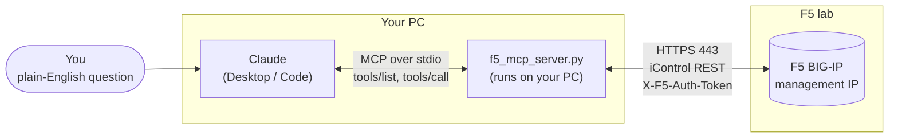
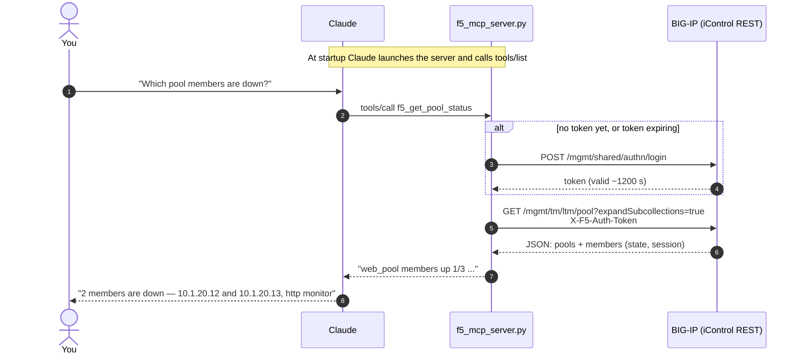
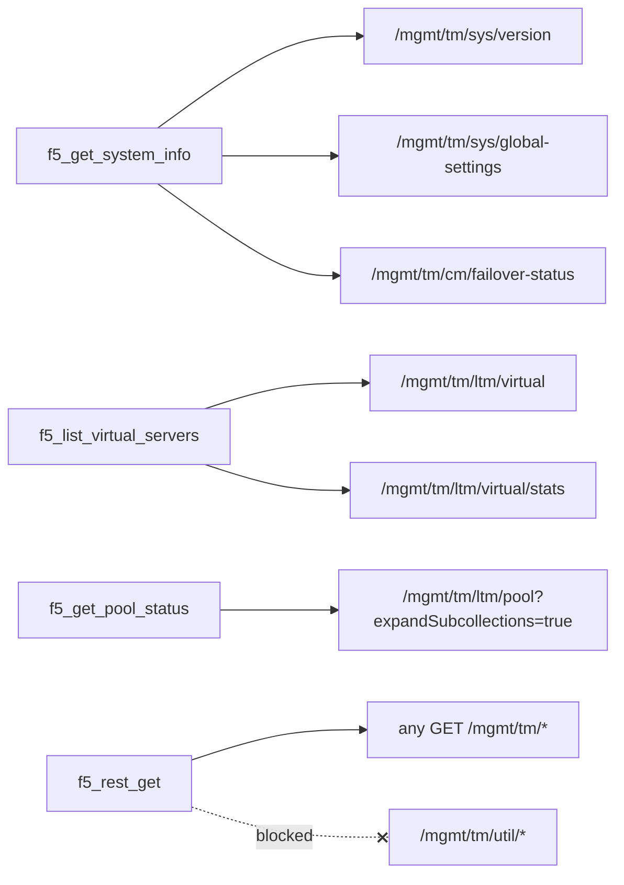
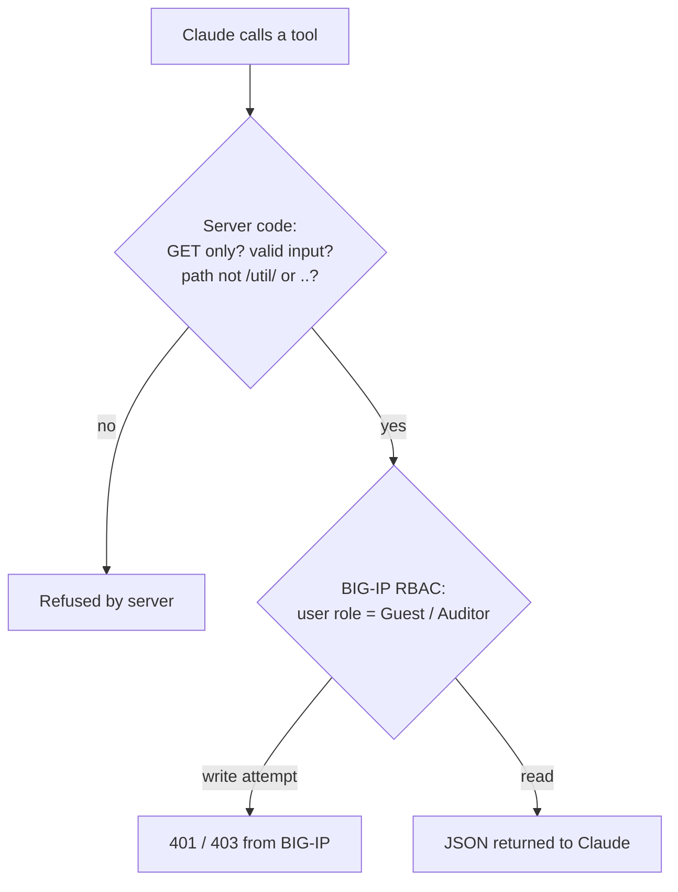

# F5 BIG-IP MCP Server for Claude

[](https://github.com/ChellaNetAI/f5-mcp-claude/actions/workflows/ci.yml)

Talk to your F5 BIG-IP lab in plain English from Claude.

```
You    : Which pool members are down?
Claude : (calls f5_get_pool_status) /Common/web_pool has 1 of 3 members up.
         10.1.20.12:80 and 10.1.20.13:80 are down — monitor http ...
```

This is a small [Model Context Protocol (MCP)](https://modelcontextprotocol.io/) server written in Python. Claude starts it on your PC, and it talks to the BIG-IP over **iControl REST**.

> **Read-only.** Every tool only sends HTTP `GET` requests, and every tool is marked `readOnlyHint: true` / `destructiveHint: false` in MCP, so Claude knows it is safe to call. Nothing on the BIG-IP is changed.

---

## How it works

### Architecture



Claude never talks to the BIG-IP directly. It only calls the tools this server exposes, and the server turns each tool call into iControl REST `GET` requests.

### What happens when you ask a question



In steps:

1. Claude launches `f5_mcp_server.py` and asks it which tools it has.
2. You ask a question. Claude picks a tool, for example `f5_get_pool_status`.
3. The server logs in with `POST /mgmt/shared/authn/login`, gets an `X-F5-Auth-Token`, and calls `GET /mgmt/tm/ltm/pool?expandSubcollections=true`.
4. The result goes back to Claude, which answers in plain English.

## Tools

| Tool | What it does | iControl REST call |
|------|--------------|--------------------|
| `f5_get_system_info` | Hostname, TMOS version/build, HA failover state | `/mgmt/tm/sys/version`, `/sys/global-settings`, `/cm/failover-status` |
| `f5_list_virtual_servers` | Virtual servers with destination, pool, availability, status reason, current connections. Options: `name_filter`, `limit` (default 50, max 200), `offset` | `/mgmt/tm/ltm/virtual` + `/stats` |
| `f5_get_pool_status` | Pools, monitor, and each member's state (up/down/user-disabled). Options: `pool` (one pool, e.g. `/Common/web_pool`), `name_filter`, `limit`, `offset` | `/mgmt/tm/ltm/pool?expandSubcollections=true` |
| `f5_rest_get` | Any read-only GET under `/mgmt/tm/` (monitors, profiles, self IPs, provisioning …) | whatever path Claude needs |

`f5_rest_get` blocks `/mgmt/tm/util/*` (also URL-encoded forms like `%75til`) and `..`, because endpoints like `util/bash` can run commands. Output is capped at 20,000 characters, so ask Claude to use `?$select=` for big objects.

Large boxes are handled with paging: list tools return 50 objects by default and end with a line like `-- showing 50 of 812 (offset 0); more available, call again with offset=50`. Claude follows that hint on its own.

Errors come back as proper MCP tool errors (`isError: true`) with a hint, for example *"User 'claude-ro' is not allowed to read ... (HTTP 403). Give the user a role that can read this object, e.g. Auditor."*

### Tool → iControl REST map



### Two layers of read-only protection



Even if the code had a bug, the BIG-IP user's role would still block any change. That's why the setup below uses a dedicated read-only user.

---

## Requirements

- Python 3.10 or higher
- Claude Desktop or Claude Code
- A BIG-IP (lab VE is fine) whose management IP is reachable from your PC on TCP 443
- A BIG-IP user that is allowed to use iControl REST

## Setup

### 1. Create a read-only user on the BIG-IP (recommended)

Don't give the AI your `admin` account. Create a separate user with the **Guest** role, so BIG-IP itself blocks any change:

```bash
tmsh create auth user claude-ro password 'Str0ngPass!' partition-access add { all-partitions { role guest } } shell none
tmsh save sys config
```

Test it from your PC. You should get JSON back with a `token`:

```bash
curl -sk https://<F5_MGMT_IP>/mgmt/shared/authn/login \
  -H "Content-Type: application/json" \
  -d '{"username":"claude-ro","password":"Str0ngPass!","loginProviderName":"tmos"}'
```

> **Version note.** Whether a non-admin user can use iControl REST depends on the TMOS version. On older releases (for example 11.x/12.x), REST was limited to Administrator unless the user was added to the `iControl_REST_API_User` role. If the `curl` login above returns 401 for a non-admin user, check the role and your version's documentation. If some objects return 403, try the **Auditor** role next. It is still read-only.

### 2. Clone and install

```bash
git clone https://github.com/<your-user>/f5-mcp-claude.git
cd f5-mcp-claude
python -m venv .venv
# Windows: .venv\Scripts\activate     Linux/Mac: source .venv/bin/activate
pip install -r requirements.txt
```

### 3. Configure

Copy the example file and fill in your values:

```bash
cp .env.example .env      # Windows: copy .env.example .env
```

```ini
F5_HOST=192.168.1.245
F5_USER=claude-ro
F5_PASSWORD=Str0ngPass!
F5_VERIFY_SSL=false
```

`.env` is in `.gitignore`. Never commit it.

### 4. Test the server on its own

```bash
python f5_mcp_server.py
```

It should print `Starting f5_mcp for 192.168.1.245` and then wait for input. It also warns if TLS verification is off. Press `Ctrl+C` to stop it. Claude will start the server by itself from now on.

### 5. Connect to Claude

#### Claude Desktop

Open **Settings → Developer → Edit Config**. This opens `claude_desktop_config.json`. Add the following, using **full paths** for your machine:

**Windows**
```json
{
  "mcpServers": {
    "f5-bigip": {
      "command": "C:\\Users\\you\\f5-mcp-claude\\.venv\\Scripts\\python.exe",
      "args": ["C:\\Users\\you\\f5-mcp-claude\\f5_mcp_server.py"]
    }
  }
}
```

**macOS / Linux**
```json
{
  "mcpServers": {
    "f5-bigip": {
      "command": "/Users/you/f5-mcp-claude/.venv/bin/python",
      "args": ["/Users/you/f5-mcp-claude/f5_mcp_server.py"]
    }
  }
}
```

Fully quit Claude Desktop (from the tray icon, not just the window) and open it again. **f5-bigip** should now appear in the tools / connectors menu.

> The server always reads the `.env` file that sits next to `f5_mcp_server.py`, whatever folder Claude starts it from. You can also put the variables in an `"env": { "F5_HOST": "...", ... }` block in the Claude config. Environment variables set there take priority over `.env`.

#### Claude Code

```bash
claude mcp add f5-bigip -- /full/path/.venv/bin/python /full/path/f5_mcp_server.py
```

## Try it

- "What version is my BIG-IP running, and is it active or standby?"
- "List all virtual servers. Which ones are not available?"
- "Show me pool members that are down and which monitor they use."
- "Show the HTTP monitors configured on the box."
- "Which modules are provisioned?"

---

## Troubleshooting

| Symptom | Check |
|---------|-------|
| Tools don't appear in Claude | Paths in the config must be absolute. Fully restart Claude Desktop. On Windows, check `%APPDATA%\Claude\logs\mcp-server-f5-bigip.log` |
| `BIG-IP rejected login ... (HTTP 401)` | Wrong user/password, or the user's role has no REST access on your TMOS version (see the version note in step 1). Retest with the `curl` login above |
| `Cannot reach BIG-IP` / `did not answer` | Ping the mgmt IP, then run `curl -k https://<ip>/` from the same PC. Check `tmsh list sys httpd allow`. On a busy box, raise `F5_TIMEOUT` |
| `HTTP 403` on some objects | The user role is too low for that object. Try Auditor |

## Security notes

- Use a **dedicated read-only user**. RBAC on the BIG-IP is the real guardrail, not the code.
- Keep credentials in `.env` or the Claude config `env` block. Never put them in the chat.
- TLS: lab boxes use a self-signed mgmt certificate, so verification is off by default and the server logs a warning. For anything beyond a lab, export the mgmt certificate and set `F5_CA_BUNDLE=/path/to/cert.pem`.
- Restrict who can reach the mgmt port with `tmsh modify sys httpd allow replace-all-with { <your-PC-IP> }`.
- This server is intended for **lab** use. Do not point it at production without your change and security process.

## Development

CI (GitHub Actions) runs on every push and once a week. It lints the code with ruff, including security rules, and checks that the server starts and lists 4 read-only tools on MCP SDK 1.x and 2.x. Dependabot opens a pull request when a dependency has a new release.

## License

MIT
